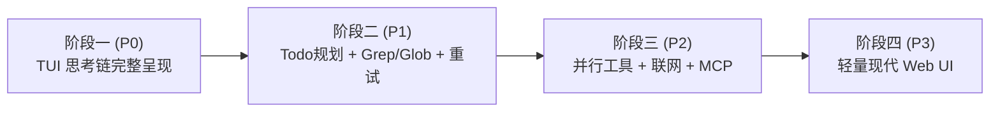

# Mini-Agent 架构演进与能力升级路线图 (Roadmap)

本文档系统性梳理 Mini-Agent 当前核心架构资产、能力缺口分析，以及下一阶段的演进路线规划。

---

## 一、现状与能力矩阵对照 (Gap Analysis)

根据对 Mini-Agent 内核代码的全面审计，当前底座能力与成熟 Agent 对照如下：

### 1. 已具备的核心优势（坚实底座）
* **单层 ReAct 执行循环**：基于事件流的 `loop.py`，完整覆盖 `agent.start`、`agent.delta`、`tool.start`、`tool.result`、`agent.end`。
* **工具容错自愈体系**：`ToolRegistry` 在工具不存在、参数不合法或运行时异常时永不崩溃，而是返回结构化引导提示，驱动大模型自我修正。
* **智能滑动窗口压缩**：`compaction.py` 实现六段式结构化摘要检查点，原子保护首轮提问与最新轮次，长上下文自动释放空间。
* **DAG 会话树版本拓扑**：`session.py` 支持非线性版本历史记录、`/undo` 无损撤回、`/tree` 拓扑可视化与 `/checkout` 任意分支检出。
* **现代化零闪烁 TUI**：基于 `@earendil-works/pi-tui` 的行级差量补丁与 DEC 2026 同步输出保护，支持 ANSI Markdown 高亮与双行遥测底栏。

### 2. 核心缺口与能力短板
| 层次 | 缺失能力 | 现状与影响 | 优先级 |
|---|---|---|---|
| **体验层** | **思考链 (Thinking) 输出** | 前端 `AssistantMessage` 虽接收了 `reasoning_delta`，但未渲染文字正文，导致思考过程不可见。 | **P0 (即时修复)** |
| **编排层** | **任务规划与 Todo 跟踪** | 无显式任务拆解与待办清单，多步复杂任务（5 步以上）容易偏航、遗漏或死循环。 | **P1** |
| **检索层** | **专用代码搜索 (Grep/Glob)** | 依赖 `bash` 调命令行 grep/find，消耗大量上下文 Token 且跨平台体验不一致。 | **P1** |
| **稳定性** | **LLM API 指数退避重试** | 遭遇网络偶发中断、网关 429 限流或 500 时直接报错中断，缺乏弹性重试。 | **P1** |
| **性能层** | **并行工具执行** | 模型单轮返回多个 `tool_calls` 时采用串行 `await`，无法利用并发加速。 | **P2** |
| **生态层** | **网络访问 (Search/Fetch)** | 无法实时检索外部最新官方文档、GitHub Issues 或抓取网页内容。 | **P2** |
| **生态层** | **MCP 协议支持** | 扩展工具需硬编码 Python，无法接入海量开源 MCP 服务器（Git、Postgres 等）。 | **P2** |
| **形态层** | **轻量现代化 Web UI** | 终端环境受限于字符网格，缺乏富文本一键复制代码、可视化分支图等大屏体验。 | **P3** |

---

## 二、分阶段演进路线规划

### 阶段一：即时收尾与体验闭环（P0 - ✅ 已完成）
* **目标**：彻底解决终端内“看不到模型思考逻辑”的体验盲区。
* **关键交付**：
  1. **实时打字机流式**：在思考进行期间，以暗色斜体（`chalk.dim.italic`）流式打字输出思考内容；
  2. **智能折叠与展开**：思考结束后，紧凑显示标签 `💭 Thought for Xs [N tokens]`，支持 `/thinking` 切换展开全文；
  3. **历史回放完全保真**：在 `/resume` 恢复会话时，完整复原历史各轮次的思考记录与流式状态。

### 阶段二：核心编排与认知增强（P1 - ✅ 已完成）
* **目标**：解决 Agent 处理多步骤任务时“容易走偏、容易死循环、代码检索慢”的核心短板。
* **关键交付**：
  1. **内置 Todo 任务规划工具 (`todo`)**：
     - 支持添加 (`add`)、更新状态 (`update`: pending/in_progress/completed/cancelled)、查看清单 (`list`)、清空 (`clear`)；
     - 注入系统 Prompt 引导模型在多步骤复杂任务时主动规划和推进。
  2. **专用代码搜索与模式匹配工具 (`grep` & `glob`)**：
     - `grep`：原生 Python 正则与关键词搜索，提供精确文件名与行号，默认剪枝过滤 `.git`、`node_modules`、`__pycache__`、`.venv` 等，自动跳过二进制文件；
     - `glob`：基于通配符快速匹配工作区文件路径清单。
  3. **LLM API 指数退避重试 (Exponential Backoff & Jitter)**：
     - 在 `ai/client.py` 内部支持请求自动重试，捕获网络异常与临时服务端报错，带有指数退避倍率与随机抖动，对 400/401 快速穿透抛错。

### 阶段三：工具生态与并发执行（P2 - ✅ 已完成）
* **目标**：拓宽 Agent 获取外部知识的边界，并大幅加速多工具调度吞吐。
* **关键交付**：
  1. **并行工具调度 (`loop.py`)**：
     - 在 `mini_agent/core/loop.py` 中，支持多工具并发异步调度与结果流式抛送；
     - 严格保持工具调用在 Context 历史消息中的顺序保真度，单个工具崩溃具备独立异常隔离。
  2. **联网检索与网页提取工具 (`web_search` & `web_fetch`)**：
     - `web_fetch`：抓取指定 URL 页面，内置轻量 DOM 流式净化并转成高可读 Markdown，提供 50KB 默认防 Token 爆炸截断；
     - `web_search`：关键词互联网检索，默认双引擎设计（优先 Tavily API，平滑回退免 Key 的 DuckDuckGo HTML 引擎）。
  3. **Model Context Protocol (MCP) 客户端集成 (`mini_agent/mcp/`)**：
     - 基于标准 JSON-RPC 2.0 over Stdio 协议实现 `StdioMCPClient`，支持完整生命周期与安全握手；
     - 提供 `MCPToolWrapper` 与 `MCPManager`，支持通过工作区 `mcp_servers.json` 或 `.mcp.json` 免开发即插即用挂载外部工具生态。

### 阶段四：交互形态演进（P3）
* **目标**：提供桌面级、富文本的浏览器交互界面。
* **关键交付**：
  1. **轻量 WebSocket 桥接网关**：基于已有的 `bridge/server.py` 暴露 WebSocket 接口；
  2. **现代化单页 Web UI (`npm run web`)**：
     - 代码语法高亮（Shiki / Prism）与一键复制；
     - 可视化会话 DAG 拓扑分支图（类似 GitKraken）；
     - 折叠式工具调用抽屉与实时日志监视器。

